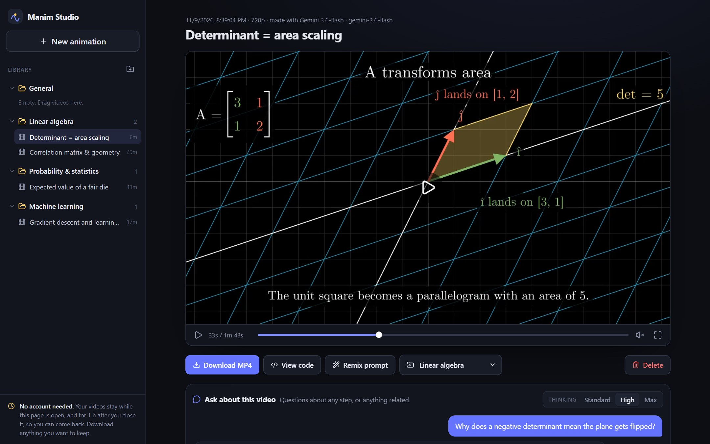
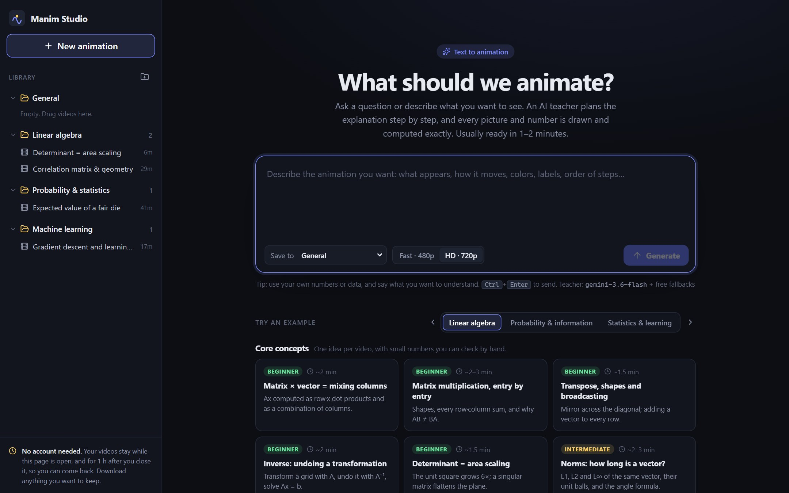
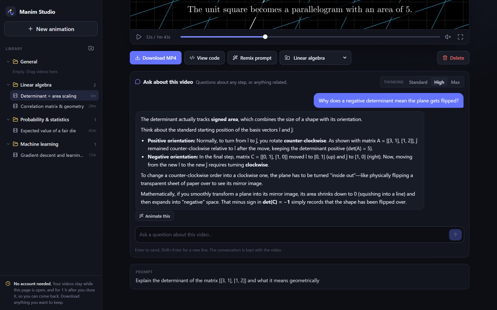
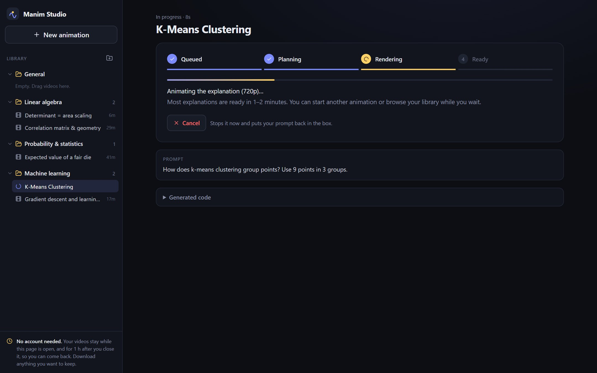

# Math Animations

**Manim Studio** is a free website that turns a question about math or machine learning into a short
animated explanation video, made in about 1–2 minutes by free AI models.

- **Any question → video**: linear algebra on moving grids, data tables and heatmaps, plots, distributions,
  classifiers, PCA, clustering, gradient descent on loss surfaces, neural networks. Your own numbers are
  used, and every number on screen is computed exactly.
- **Chat under every video**: ask follow-up questions about it (Standard / High / Max thinking), and turn
  any answer into a new video with **Animate this**.
- **Free example library**: ready-made prompts covering linear algebra, probability, statistics and ML.
- **No account**: folders for your videos, download the MP4 and its code; videos stay while the page is
  open and for 1 hour after you close it.



| Ask a question or pick an example | Ask follow-up questions under the video | Planned in seconds, then rendered |
|:---:|:---:|:---:|
|  |  |  |

## Setup (Windows / PowerShell, with uv)

```powershell
uv python install 3.12
uv sync
uv run manim checkhealth
```

## Run Manim Studio locally

Copy `.env.example` to `.env` and fill in the free keys (Gemini, NVIDIA, Z.ai). With no keys at all
it still works through the keyless OVHcloud fallback, just slower.

```powershell
# terminal 1: backend on :8000 (reads keys from .env)
uv run uvicorn server.main:app --reload --reload-dir server

# terminal 2: frontend dev server on :5173 (proxies /api to :8000)
cd frontend; npm install; npm run dev
```

Open <http://localhost:5173>. Or build once (`cd frontend; npm run build`) and use
<http://localhost:8000>, where FastAPI serves the built site.

**With Docker** (includes LaTeX, the same image as production):

```powershell
docker build -t manim-studio .
docker run -p 7860:7860 --env-file .env manim-studio   # → http://localhost:7860
```


## Project layout

```
server/
  main.py           FastAPI routes + serves frontend/dist
  storage.py        cookie sessions, per-session folders on disk, 1 h TTL cleanup
  jobs.py           queue: lesson plan → check → render (fallback: write code → check → fix → render) → save
  llm.py            free-provider chain with automatic fallback: gpt-oss-120b (OVHcloud) → Gemini 3.8 /
                    3.7 / 3.6 / 3.5 / 3.5-lite Flash → NVIDIA → Qwen 3.5 (OVHcloud) → GLM (Z.ai).
                    Lesson plans and chat ask the "teacher" models first (Gemini 3.6 → 3.7 → 3.8 → 3.5 → 3.5-lite)
  lesson.py         lesson plans: parse, clean, check (and repair) them, describe them for the reviewer,
                    cut them into parts that render in parallel, turn them into scene files
  reference.py      the reference library: reviewed cards per topic, with textbook chapters to read
  sources.py        gives the teacher the matching cards + a passage from the open textbook
                    Dive into Deep Learning (CC BY-SA 4.0); the sources are listed under each video
  kit/studio_lesson.py  plays a lesson plan: each caption on screen while its visual plays
  kit/lesson_ml.py  ML visuals: classes and boundaries, k-NN, residuals, polynomial fits, PCA,
                    k-means, histograms, loss curves, gradient descent, contour maps, networks
  kit/lesson_math.py    exact numbers for plans: computed matrices and decompositions (SVD, eigen),
                    worked calculations, exact fractions, {det(R)}-style caption templates
  kit/studio_kit.py layout-safe helpers (matrices, captions, worked equations, plots)
  prompts.py        teacher prompt (lesson plans), code-writing / fix prompts, chat prompt
  sandbox.py        static code checks + sandboxed subprocess render
  render_runner.py  runs inside the subprocess (audit hook, length cap)
frontend/src/       React + TypeScript UI (sidebar, composer, job + video views)
Dockerfile          one image: built frontend + API + Manim + LaTeX
hf_space/           entry point + apt/pip deps for the free Gradio/ZeroGPU Space
deploy/hf_deploy.py one-command Hugging Face Spaces deploy
tests/              fast checks, no rendering or network:  uv run python tests/test_lessons.py
tools/              render_plan.py (render the test plans), run_job.py (one prompt through the whole
                    pipeline), contact_sheet.py (frames of a video as one image)
```
